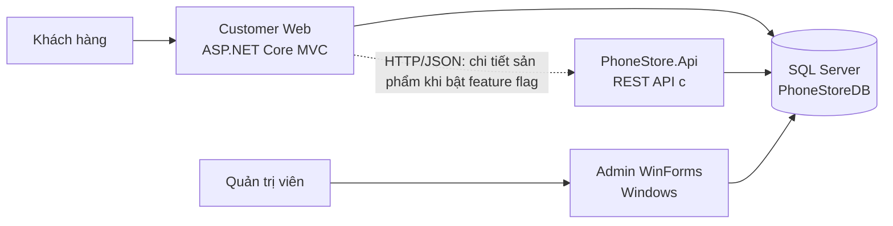

# PhoneStore

PhoneStore là hệ thống quản lý và bán điện thoại xây dựng trên .NET 8. Dự án phục vụ hai nhóm người dùng:

- **Khách hàng** sử dụng website để tìm sản phẩm, quản lý giỏ hàng và đặt hàng.
- **Quản trị viên** sử dụng ứng dụng Windows Forms để quản lý dữ liệu và theo dõi hoạt động cửa hàng.

Hệ thống gồm Customer Web, REST API danh mục , Admin WinForms và các thư viện nghiệp vụ/truy cập dữ liệu dùng chung. Web, API và SQL Server có thể chạy bằng Docker Compose; Admin tiếp tục chạy trực tiếp trên Windows.

## Mục lục

- [Công nghệ](#công-nghệ)
- [Chức năng chính](#chức-năng-chính)
- [Hình ảnh giao diện](#hình-ảnh-giao-diện)
- [Kiến trúc hệ thống](#kiến-trúc-hệ-thống)
- [Cấu trúc repository](#cấu-trúc-repository)
- [Cài đặt và chạy dự án](#cài-đặt-và-chạy-dự-án)
- [Cấu hình môi trường](#cấu-hình-môi-trường)
- [API Reference](#api-reference)
- [Kiểm thử](#kiểm-thử)
- [Giới hạn và hướng phát triển](#giới-hạn-và-hướng-phát-triển)
- [Tài liệu](#tài-liệu)

## Công nghệ

| Thành phần | Công nghệ đã xác minh |
|---|---|
| Ngôn ngữ và runtime | C#, .NET 8; SDK `8.0.427` theo `global.json` |
| Customer Web | ASP.NET Core MVC/Razor, HTML, CSS, JavaScript |
| REST API | ASP.NET Core Web API, Swagger/OpenAPI |
| Admin Desktop | Windows Forms, `net8.0-windows` |
| Truy cập dữ liệu | Entity Framework Core `8.0.28`, SQL Server provider |
| Cơ sở dữ liệu | Microsoft SQL Server 2022 |
| Container | Docker, Docker Compose, Linux containers |
| Kiểm thử | xUnit, ASP.NET Core TestServer, EF Core SQLite |
| Quản lý mã nguồn | Git, GitHub |

## Chức năng chính

### Customer Web

- Đăng ký, đăng nhập, đăng xuất và cập nhật hồ sơ khách hàng.
- Xem trang chủ, danh sách và chi tiết sản phẩm.
- Tìm kiếm, lọc theo thương hiệu/danh mục và sắp xếp sản phẩm.
- Thêm, cập nhật số lượng và xóa sản phẩm trong giỏ hàng.
- Đặt hàng với giá và tồn kho được kiểm tra phía máy chủ.
- Xem lịch sử, chi tiết và trạng thái đơn hàng.
- Hủy đơn khi trạng thái nghiệp vụ cho phép; tồn kho được hoàn trong transaction.
- Bảo vệ các trang tài khoản/đơn hàng bằng cookie authentication và quyền Customer.

### Admin WinForms

- Đăng nhập và kiểm tra quyền quản trị.
- Dashboard KPI, biểu đồ trạng thái đơn hàng và doanh thu.
- Quản lý thương hiệu, danh mục, sản phẩm và ảnh sản phẩm.
- Quản lý khách hàng.
- Xem chi tiết và cập nhật trạng thái đơn hàng theo luồng cho phép.
- Báo cáo doanh thu, sản phẩm bán chạy và cảnh báo tồn kho.

### Web API

Project thực tế là `PhoneStore.Api`. API V1 hiện chỉ đọc và cung cấp:

- Health/readiness của dịch vụ và SQL Server.
- Danh sách, tìm kiếm, lọc, sắp xếp và phân trang sản phẩm active.
- Chi tiết sản phẩm active.
- Danh sách thương hiệu và danh mục active.
- Problem Details, trace ID, rate limiting và request timeout.

API không xử lý tài khoản, giỏ hàng, checkout hoặc đơn hàng. Customer Web chỉ gọi API cho chi tiết sản phẩm khi `CatalogApi:Enabled=true`; các nghiệp vụ còn lại sử dụng trực tiếp tầng Business/Data.

## Hình ảnh giao diện

### Customer Web

Giao diện dành cho khách hàng tìm kiếm sản phẩm, quản lý giỏ hàng và đặt hàng.


### Admin WinForms

Giao diện dành cho quản trị viên quản lý dữ liệu và theo dõi hoạt động cửa hàng.


## Kiến trúc hệ thống



- `PhoneStore.Web`, `PhoneStore.Api` và `PhoneStore.Admin` sử dụng các project `PhoneStore.Business`, `PhoneStore.Data` và `PhoneStore.Models` theo dependency thực tế.
- Entity Framework Core cung cấp `PhoneStoreDbContext` và kết nối SQL Server.
- Admin kết nối SQL Server trực tiếp, không gọi REST API.
- Trong Docker Compose, Web gọi API qua service DNS `api` và Web/API gọi SQL qua service `db`.
- Khi Admin chạy trên Windows, phải cấu hình nó tới cùng SQL Docker nếu muốn thấy dữ liệu do Customer Web Docker tạo.

## Cấu trúc repository

```text
PhoneStore/
├── src/
│   ├── PhoneStore.Web/          # Customer Web MVC/Razor
│   ├── PhoneStore.Api/          # REST API
│   ├── PhoneStore.Admin/        # Admin WinForms
│   ├── PhoneStore.Business/     # Use case và quy tắc nghiệp vụ
│   ├── PhoneStore.Data/         # EF Core DbContext, mapping và data stores
│   └── PhoneStore.Models/       # Entity, enum và DTO/model dùng chung
├── tests/
│   ├── PhoneStore.Tests/        # Unit/integration tests cách ly
│   └── PhoneStore.SqlIntegration/ # Kiểm tra SQL/UI tích hợp có kiểm soát
├── tools/
│   ├── PhoneStore.AdminBootstrap/
│   └── PhoneStore.CatalogImport/
├── scripts/                     # Script vận hành local an toàn
├── docs/                        # Tài liệu phát triển và phân tích hệ thống
├── Dockerfile                   # Image Customer Web
├── docker-compose.yml           # Web, API và SQL Server
├── docker-compose.restore.yml   # Override restore/tài nguyên cho môi trường đã chuẩn bị
└── PhoneStore.sln
```

## Cài đặt và chạy dự án

### Yêu cầu phần mềm

- Git.
- .NET 8 SDK tương thích `global.json`.
- Docker Desktop chạy Linux containers để dùng Docker Compose.
- Windows 10/11 để chạy Admin WinForms.
- `sqlcmd` nếu dùng launcher Admin kết nối SQL Docker.


### Chuẩn bị source

```powershell
git clone https://github.com/vuvantai14/PhoneStore.git
cd PhoneStore
dotnet tool restore
dotnet restore PhoneStore.sln
dotnet build PhoneStore.sln
```

### A. Chạy Web, API và SQL Server bằng Docker Compose

Tạo `.env` nếu file này chưa tồn tại, sau đó điền mật khẩu SQL mạnh và đường dẫn uploads tuyệt đối:

```powershell
if (-not (Test-Path .env)) { Copy-Item .env.example .env }
```


```powershell
docker compose -f docker-compose.yml config --quiet
docker compose -f docker-compose.yml up -d --build
docker compose -f docker-compose.yml ps
```

Địa chỉ mặc định:

- Customer Web: <http://localhost:5015>
- API health: <http://localhost:5025/api/health>
- Swagger trong môi trường Development: <http://localhost:5025/swagger>
- SQL Server từ Windows host: `127.0.0.1,14334`

Xem log:

```powershell
docker compose -f docker-compose.yml logs -f web api db
```

Dừng dịch vụ nhưng giữ container/volume dữ liệu:

```powershell
docker compose -f docker-compose.yml stop
```


### B. Chạy Admin WinForms với SQL Docker


Admin WinForms chạy trực tiếp trên Windows và kết nối đến cùng cơ sở dữ liệu SQL Server Docker với Customer Web.

Sau khi khởi động Docker Compose, mở PowerShell tại thư mục gốc của dự án và chạy:

```powershell
.\scripts\run-admin-docker.ps1
```

Script tự đọc cấu hình từ `.env`, thiết lập Admin sử dụng cùng SQL Server Docker với Customer Web, kiểm tra kết nối rồi khởi động Admin WinForms bằng `dotnet run`.

Có thể kiểm tra kết nối mà không mở ứng dụng:

```powershell
.\scripts\run-admin-docker.ps1 -CheckOnly
```

**Lưu ý:** Không sử dụng `dotnet run --project src/PhoneStore.Admin` nếu muốn Admin kết nối SQL Docker, vì cấu hình mặc định hiện tại kết nối SQL Server Windows.

Khi Customer Web và Admin cùng sử dụng SQL Docker, dữ liệu sản phẩm, danh mục và đơn hàng được chia sẻ giữa hai ứng dụng.


## Kiểm thử

Chạy bộ test chính trong solution:

```powershell
dotnet test tests/PhoneStore.Tests/PhoneStore.Tests.csproj
```

Các test chính sử dụng SQLite, doubles hoặc TestServer cách ly. Không tự trỏ test vào `PhoneStoreDB` đang vận hành. Project `PhoneStore.SqlIntegration` dành cho nghiệm thu SQL/WinForms có kiểm soát và cần cấu hình database test riêng


#
