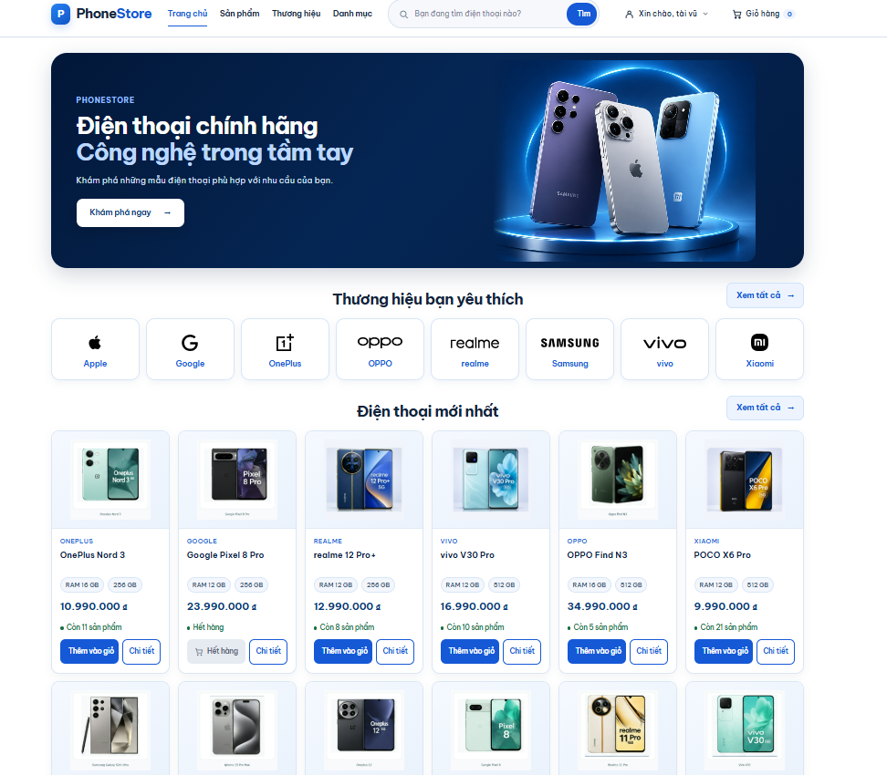
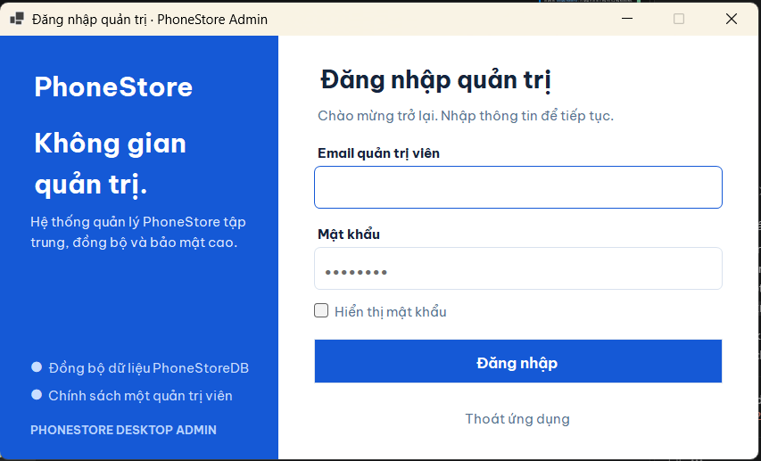
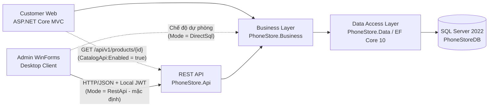

# PhoneStore

PhoneStore là hệ thống quản lý và bán điện thoại trực tuyến được phát triển trên nền tảng .NET 10. Hệ thống cung cấp ứng dụng **Customer Web** (ASP.NET Core MVC) giúp khách hàng tra cứu sản phẩm, quản lý giỏ hàng và đặt hàng, cùng ứng dụng **Admin WinForms** hỗ trợ quản trị viên vận hành danh mục, đơn hàng, khách hàng và báo cáo doanh thu. Phía backend gồm **PhoneStore.Api** (ASP.NET Core Web API), các thư viện nghiệp vụ/truy cập dữ liệu dùng chung (`PhoneStore.Business`, `PhoneStore.Data`, `PhoneStore.Models`) và cơ sở dữ liệu **SQL Server 2022**.

## Mục lục

- [Công nghệ sử dụng](#công-nghệ-sử-dụng)
- [Chức năng chính](#chức-năng-chính)
- [Hình ảnh giao diện](#hình-ảnh-giao-diện)
- [Kiến trúc hệ thống](#kiến-trúc-hệ-thống)
- [Cấu trúc repository](#cấu-trúc-repository)
- [Cấu hình môi trường](#cấu-hình-môi-trường)
- [Cài đặt và chạy dự án](#cài-đặt-và-chạy-dự-án)
- [Giới hạn và hướng phát triển](#giới-hạn-và-hướng-phát-triển)

## Công nghệ sử dụng

| Thành phần | Công nghệ & Phiên bản đã xác minh |
|---|---|
| C# / .NET | C#, .NET 10 (`net10.0`, `net10.0-windows`), SDK `10.0.403` theo `global.json` |
| ASP.NET Core MVC | Customer Web (`PhoneStore.Web`), Razor Views, Cookie Authentication, Session |
| ASP.NET Core Web API | REST API (`PhoneStore.Api`), Local JWT (`HS256`), Refresh Token, Swagger (`Swashbuckle.AspNetCore 6.6.2`) |
| Windows Forms | Admin Desktop (`PhoneStore.Admin`, `net10.0-windows`) |
| Entity Framework Core | EF Core `10.0.15`, SQL Server Provider, Code-First Migrations |
| SQL Server | Microsoft SQL Server 2022 (`mcr.microsoft.com/mssql/server:2022-latest`) |
| Docker Compose | Đóng gói và triển khai `web`, `api`, `db` trên Linux containers |

## Chức năng chính

### Customer Web

- Đăng ký, đăng nhập, đăng xuất (Cookie Authentication) và cập nhật hồ sơ khách hàng.
- Xem trang chủ, danh sách và chi tiết sản phẩm.
- Tìm kiếm theo từ khóa, lọc theo thương hiệu, danh mục, khoảng giá, RAM, bộ nhớ, tình trạng tồn kho và sắp xếp, phân trang.
- Thêm, cập nhật số lượng, xóa sản phẩm trong giỏ hàng với kiểm tra trần tồn kho thực tế.
- Đặt hàng (Checkout) có kiểm tra giá, trừ tồn kho nguyên tử trong transaction và chống gửi trùng đơn.
- Xem lịch sử, chi tiết đơn hàng và hủy đơn ở trạng thái `Pending` (tự động hoàn lại tồn kho).

### Admin WinForms

- Đăng nhập quản trị viên, kiểm tra phân quyền `Admin` và tự động quản lý phiên JWT Bearer.
- Xem Dashboard KPI, biểu đồ trạng thái đơn hàng, thống kê doanh thu theo kỳ và cảnh báo tồn kho thấp.
- Quản lý sản phẩm, thông số kỹ thuật, tải lên/sắp xếp hình ảnh sản phẩm và ngừng kinh doanh (soft-deactivation).
- Quản lý danh sách thương hiệu (`Brands`) và danh mục (`Categories`).
- Quản lý hồ sơ khách hàng, tra cứu lịch sử mua hàng và khóa/mở khóa tài khoản.
- Quản lý đơn hàng và cập nhật trạng thái đơn theo luồng nghiệp vụ (`Pending` -> `Confirmed` -> `Shipping` -> `Completed` / `Cancelled`).

## Hình ảnh giao diện

### Customer Web



### Admin WinForms



## Kiến trúc hệ thống



- **Customer Web** gọi `PhoneStore.Api` để lấy chi tiết sản phẩm khi bật `CatalogApi:Enabled = true` (tự động fallback về database nếu API lỗi/timeout) và sử dụng trực tiếp `PhoneStore.Business` / `PhoneStore.Data` cho các nghiệp vụ tài khoản, danh sách sản phẩm, giỏ hàng và đặt hàng.
- **Admin WinForms** mặc định hoạt động ở chế độ `AdminDataAccess:Mode = RestApi` giao tiếp với `PhoneStore.Api` qua Local JWT Bearer (không kết nối SQL trực tiếp), đồng thời vẫn hỗ trợ chế độ dự phòng `DirectSql` qua cấu hình.
- **REST API** và các ứng dụng dùng chung `Business Layer`, `Data Access Layer` (`PhoneStoreDbContext`) và `PhoneStore.Models` để thống nhất quy tắc nghiệp vụ trên cùng cơ sở dữ liệu `PhoneStoreDB`.

## Cấu trúc repository

```text
PhoneStore/
├── src/                        # Mã nguồn PhoneStore.Web, PhoneStore.Api, PhoneStore.Admin, Business, Data, Models
├── tests/                      # Dự án kiểm thử tự động xUnit và công cụ kiểm thử tích hợp SQL Server
├── tools/                      # Công cụ khởi tạo Admin (AdminBootstrap) và nhập danh mục (CatalogImport)
├── scripts/                    # Script vận hành Docker, chạy Admin và công cụ CI/CD
├── docs/                       # Hình ảnh giao diện và tài liệu phát triển dự án
├── Dockerfile                  # Dockerfile đóng gói Customer Web
├── docker-compose.yml          # Cấu hình Docker Compose cho Web, API và SQL Server 2022
├── .env.example                # File mẫu cấu hình biến môi trường cho Docker Compose
├── global.json                 # Cấu hình phiên bản .NET 10 SDK (10.0.403)
└── PhoneStore.sln              # Solution chính của dự án
```

## Cấu hình môi trường

- **Yêu cầu công cụ**: .NET 10 SDK (`10.0.403`), Windows 10/11 (để chạy Admin WinForms), SQL Server 2022 hoặc Docker Desktop (Linux containers).
- **Biến môi trường Docker (`.env`)**: Sao chép từ `.env.example` và cấu hình bắt buộc `MSSQL_SA_PASSWORD` (mật khẩu tài khoản `sa` đủ mạnh), `PRODUCT_UPLOADS_PATH` (đường dẫn tuyệt đối trên host lưu ảnh sản phẩm), cùng các cổng mặc định `WEB_PORT=5015`, `API_PORT=5025`, `SQL_PORT=14334`.
- **Cấu hình ứng dụng (`appsettings.json` hoặc biến môi trường)**:
  - `ConnectionStrings:PhoneStoreConnection`: Chuỗi kết nối tới cơ sở dữ liệu `PhoneStoreDB`.
  - `CatalogApi:Enabled` và `CatalogApi:BaseUrl`: Bật/tắt và khai báo địa chỉ API cho Customer Web (`http://localhost:5025/` hoặc `http://api:8080/` trong Docker).
  - `AdminDataAccess:Mode` và `AdminDataAccess:ApiBaseUrl`: Chế độ truy cập dữ liệu của Admin WinForms (`RestApi` mặc định trỏ tới `http://127.0.0.1:5025`, hoặc `DirectSql`).
  - `ApiAuthentication:Mode`: Đặt `LocalJwt` kèm `Issuer` (HTTPS URL), `Audience` và `SigningKey` (>= 32 bytes) để bật đăng nhập JWT cho REST API.

## Cài đặt và chạy dự án

### A. Chạy bằng Docker Compose

1. Clone repository và tạo file `.env` từ `.env.example` (cập nhật `MSSQL_SA_PASSWORD` và `PRODUCT_UPLOADS_PATH` trong `.env`):

```powershell
git clone https://github.com/vuvantai14/PhoneStore.git
cd PhoneStore
if (-not (Test-Path .env)) { Copy-Item .env.example .env }
```

2. Build và khởi chạy các container `db`, `api` và `web`:

```powershell
docker compose -f docker-compose.yml up -d --build
```

- **Customer Web**: `http://localhost:5015`
- **REST API Health**: `http://localhost:5025/api/health/ready`
- **SQL Server Docker**: `127.0.0.1,14334`

3. Chạy Admin WinForms trên Windows:

```powershell
# Chế độ mặc định (RestApi kết nối tới http://127.0.0.1:5025)
dotnet run --project src/PhoneStore.Admin/PhoneStore.Admin.csproj

# Hoặc chạy kết nối trực tiếp vào cùng SQL Server Docker (DirectSql, yêu cầu cài sqlcmd)
$env:AdminDataAccess__Mode = "DirectSql"
.\scripts\run-admin-docker.ps1
```

### B. Chạy local

1. Khôi phục package, build solution và cập nhật database trên SQL Server local:

```powershell
dotnet tool restore
dotnet restore PhoneStore.sln
dotnet build PhoneStore.sln
dotnet ef database update --project src/PhoneStore.Data/PhoneStore.Data.csproj --startup-project src/PhoneStore.Web/PhoneStore.Web.csproj
```

2. Mở 3 cửa sổ PowerShell để chạy lần lượt REST API, Customer Web và Admin WinForms:

```powershell
# Terminal 1 - Chạy PhoneStore.Api (cổng 5025, bật LocalJwt)
$env:ApiAuthentication__Mode = "LocalJwt"
$env:ApiAuthentication__LocalJwt__Issuer = "https://phonestore.local"
$env:ApiAuthentication__LocalJwt__Audience = "phonestore-api"
$env:ApiAuthentication__LocalJwt__SigningKey = "<ChuoiBiMatNgauNhienToiThieu32KyTu>"
dotnet run --project src/PhoneStore.Api/PhoneStore.Api.csproj --urls "http://127.0.0.1:5025"

# Terminal 2 - Chạy PhoneStore.Web (http://localhost:5015)
dotnet run --project src/PhoneStore.Web/PhoneStore.Web.csproj --launch-profile http

# Terminal 3 - Chạy PhoneStore.Admin
dotnet run --project src/PhoneStore.Admin/PhoneStore.Admin.csproj
```

