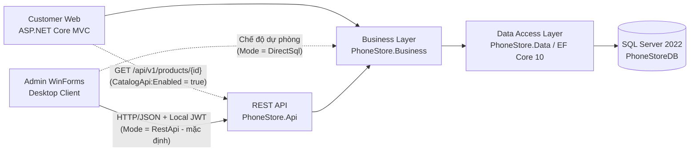

# PhoneStore

PhoneStore là hệ thống quản lý và bán điện thoại trực tuyến xây dựng trên nền tảng **.NET 10**. Hệ thống gồm **Customer Web** (ASP.NET Core MVC) phục vụ khách hàng mua sắm, **Admin WinForms** hỗ trợ quản trị viên vận hành cửa hàng, và **PhoneStore.Api** (ASP.NET Core Web API) dùng chung tầng nghiệp vụ/dữ liệu trên **SQL Server 2022**.

## Công nghệ sử dụng

| Thành phần | Công nghệ |
|---|---|
| Nền tảng | C#, .NET 10 (`net10.0`, `net10.0-windows`), SDK `10.0.403` (`global.json`) |
| Customer Web | ASP.NET Core MVC, Razor Views, Cookie Authentication, Session |
| REST API | ASP.NET Core Web API, Local JWT (`HS256`), Refresh Token, Swagger (`Swashbuckle.AspNetCore 6.6.2`) |
| Admin Desktop | Windows Forms (`PhoneStore.Admin`) |
| Truy cập dữ liệu | Entity Framework Core `10.0.15`, SQL Server Provider, Code-First Migrations |
| Cơ sở dữ liệu & Hạ tầng | Microsoft SQL Server 2022, Docker Compose (Linux containers) |

## Chức năng chính

### Customer Web

- Đăng ký, đăng nhập, đăng xuất và cập nhật hồ sơ cá nhân.
- Xem trang chủ, danh sách và chi tiết sản phẩm.
- Tìm kiếm theo từ khóa, lọc theo thương hiệu, danh mục, giá, RAM, bộ nhớ, tồn kho, sắp xếp và phân trang.
- Quản lý giỏ hàng (thêm, cập nhật số lượng, xóa) có kiểm tra tồn kho thực tế.
- Đặt hàng (Checkout) với kiểm tra giá, trừ tồn kho nguyên tử trong transaction và chống gửi trùng đơn.
- Xem lịch sử, chi tiết đơn hàng và hủy đơn ở trạng thái `Pending` (tự động hoàn tồn kho).

### Admin WinForms

- Đăng nhập quản trị viên, xác thực phân quyền `Admin` và tự động quản lý phiên JWT Bearer.
- Xem Dashboard KPI, biểu đồ trạng thái đơn hàng, báo cáo doanh thu theo kỳ và cảnh báo tồn kho thấp.
- Quản lý sản phẩm, thông số kỹ thuật, tải lên/sắp xếp hình ảnh sản phẩm và ngừng kinh doanh (soft-deactivation).
- Quản lý thương hiệu (`Brands`), danh mục (`Categories`) và hồ sơ khách hàng (tra cứu lịch sử mua, khóa/mở khóa tài khoản).
- Quản lý đơn hàng và cập nhật trạng thái (`Pending` -> `Confirmed` -> `Shipping` -> `Completed` / `Cancelled`).

## Hình ảnh giao diện

**Customer Web**


**Admin WinForms**


## Kiến trúc hệ thống



- **Customer Web** kết nối tầng `Business`/`Data` cho các luồng mua sắm, và có thể gọi `PhoneStore.Api` để lấy chi tiết sản phẩm khi bật `CatalogApi:Enabled = true` (tự động fallback về database khi API lỗi hoặc timeout).
- **Admin WinForms** mặc định chạy chế độ `RestApi` giao tiếp với `PhoneStore.Api` qua Local JWT (hỗ trợ dự phòng `DirectSql` bằng cấu hình).

## Cài đặt và chạy dự án

### Yêu cầu

- [.NET 10 SDK](https://dotnet.microsoft.com/) (`10.0.403`)
- Docker Desktop
- Git
- Windows 10/11 (để chạy Admin WinForms)

### Chuẩn bị môi trường

PhoneStore sử dụng **SQL Server 2022** chạy trong Docker. Trước khi chạy lần đầu, cần chuẩn bị file `.env`, cơ sở dữ liệu `PhoneStoreDB` và cấu hình `.NET User Secrets` theo hướng dẫn chi tiết tại [`docs/LOCAL_DEVELOPMENT.md`](docs/LOCAL_DEVELOPMENT.md) (bao gồm cách tạo tài khoản Admin ban đầu với [`tools/PhoneStore.AdminBootstrap`](tools/PhoneStore.AdminBootstrap)).

### Chạy Local

Sau khi đã cấu hình môi trường, mở từng cửa sổ PowerShell riêng tại thư mục gốc repository và chạy lần lượt:

```powershell
# Khởi động SQL Server Docker
docker compose -f docker-compose.yml up -d db

# Terminal 1 - REST API
$env:ASPNETCORE_ENVIRONMENT = "Development"
dotnet run --project src/PhoneStore.Api/PhoneStore.Api.csproj --no-launch-profile --urls "http://127.0.0.1:5025"

# Terminal 2 - Customer Web
$env:ASPNETCORE_ENVIRONMENT = "Development"
dotnet run --project src/PhoneStore.Web/PhoneStore.Web.csproj --no-launch-profile --urls "http://127.0.0.1:5016"

# Terminal 3 - Admin WinForms
dotnet run --project src/PhoneStore.Admin/PhoneStore.Admin.csproj
```

### Chạy Docker Compose

Với môi trường mới đã cấu hình `.env`:

```powershell
docker compose -f docker-compose.yml up -d --build
```

### Địa chỉ truy cập

| Ứng dụng | Địa chỉ |
|---|---|
| Customer Web Local | `http://127.0.0.1:5016` |
| Customer Web Docker | `http://localhost:5015` |
| REST API Local | `http://127.0.0.1:5025` |
| API Health Local | `http://127.0.0.1:5025/api/health/ready` |
| SQL Server Docker | `127.0.0.1,14334` |

Lưu ý: Không nên chạy đồng thời các ứng dụng sử dụng trùng cổng (ví dụ hai tiến trình cùng lắng nghe trên cổng `5015` hoặc `5025`).

## Hướng dẫn sử dụng

**Customer Web**
- Truy cập `http://127.0.0.1:5016` (Local) hoặc `http://localhost:5015` (Docker).
- Đăng ký tài khoản mới hoặc đăng nhập, tìm kiếm/lọc và xem chi tiết sản phẩm.
- Thêm sản phẩm vào giỏ hàng, điều chỉnh số lượng và đặt hàng.
- Theo dõi lịch sử đơn hàng và hủy đơn khi còn ở trạng thái `Pending`.

**Admin WinForms**
- Đảm bảo `PhoneStore.Api` đang chạy tại `http://127.0.0.1:5025`, sau đó khởi chạy `PhoneStore.Admin`.
- Đăng nhập bằng tài khoản `Admin` đã được khởi tạo trên hệ thống.
- Quản lý sản phẩm, hình ảnh, thương hiệu, danh mục, khách hàng và cập nhật trạng thái đơn hàng.
- Theo dõi Dashboard tổng quan và báo cáo doanh thu theo kỳ hoặc khoảng thời gian tùy chọn.
