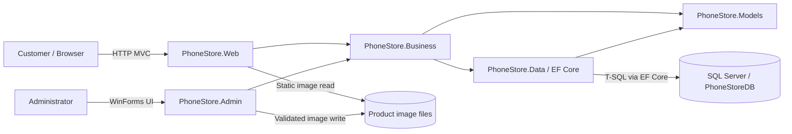
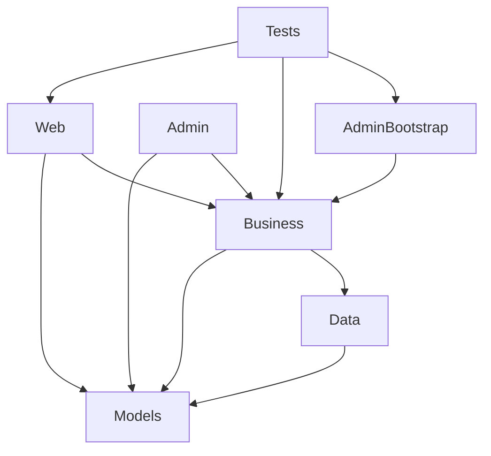

# S31.2 — PhoneStore Architecture Audit for Chapter 4

Ngày xác minh: 2026-11-13  
Phạm vi: đọc solution, project references, entry point, controller/form, service/store, `DbContext`, xác thực, luồng checkout/cập nhật đơn và xử lý lỗi. Không build/test, không chạy ứng dụng, không truy vấn ghi và không sửa database.

## A. Architecture Overview

### A.1 Kết luận kiến trúc thực tế

PhoneStore là **layered modular monolith** triển khai thành hai tiến trình giao diện độc lập:

- **Customer Web**: ASP.NET Core MVC/Razor trên .NET 8, phục vụ trình duyệt qua HTTP/HTTPS.
- **Admin Desktop**: C# WinForms trên .NET 8 Windows, chạy trực tiếp trên máy quản trị.
- **Shared application libraries**: `PhoneStore.Business`, `PhoneStore.Data`, `PhoneStore.Models` được cả Web và Admin nạp trong cùng tiến trình tương ứng.
- **Persistence**: cả Web và Admin dùng EF Core SQL Server và cùng connection key `PhoneStoreConnection` đến `localhost/PhoneStoreDB` bằng Windows Authentication trong cấu hình main đã kiểm tra. Mật khẩu không nằm trong connection string main.
- **Product image storage**: Web đọc static files; Admin ghi file qua `IProductImageStorage`/`LocalProductImageStorage` vào thư mục uploads được cấu hình. Đây là filesystem coupling, không phải object storage/service riêng.

Không tìm thấy REST API nội bộ, microservice, message queue, event bus hoặc giao tiếp tiến trình trực tiếp giữa Web và Admin. Sự nhất quán giữa hai ứng dụng đến từ **cùng database và cùng quy tắc Business/Data được biên dịch dùng chung**.



### A.2 Phân lớp thực tế

| Lớp | Trách nhiệm thực tế | Ghi chú |
|---|---|---|
| Presentation Web | Controllers, Razor Views/ViewModels, cookie/session, antiforgery, HTTP routing | Controller gọi Business; `BrandsController`/`CategoriesController` còn đọc `PhoneStoreDbContext` trực tiếp |
| Presentation Admin | Login/MainForm, UserControls, Dialogs, in-memory session, UI state | Dùng `CatalogManagementGateway` để tạo DI scope cho từng thao tác |
| Business | Authentication, catalog, purchasing, management, reporting, validation và state-transition | Có interface service, nhưng project tham chiếu trực tiếp Data |
| Data | `PhoneStoreDbContext`, Fluent configurations, migrations, query/write Stores | Stores đóng vai trò repository chuyên biệt; không có generic repository/UoW riêng |
| Models | Entities, enums, request/result/read models dùng chung | Không phụ thuộc project khác |

Đây **không phải Clean Architecture thuần**: dependency `Business -> Data` khiến application/business layer biết các store cụ thể. EF `DbContext`/transaction vẫn được cô lập chủ yếu trong Data, nhưng dependency inversion chưa áp dụng nhất quán.

## B. Project Dependencies

### B.1 Bảy project trong `PhoneStore.sln`

| Project | Target | Trách nhiệm | Project references |
|---|---|---|---|
| `PhoneStore.Models` | `net8.0` | Entity, enum, DTO/read/result models dùng chung | Không có |
| `PhoneStore.Data` | `net8.0` | EF Core SQL Server, DbContext, Fluent API, migrations, stores | Models |
| `PhoneStore.Business` | `net8.0` | Dịch vụ nghiệp vụ, validation, transaction orchestration | Models, Data |
| `PhoneStore.Web` | `net8.0` Web | Customer MVC/Razor, auth cookie, session cart, checkout | Models, Business; nhận Data bắc cầu qua Business |
| `PhoneStore.Admin` | `net8.0-windows` WinExe | Admin WinForms, shell, controls/dialogs, gateway/session | Models, Business; nhận Data bắc cầu qua Business |
| `PhoneStore.Tests` | `net8.0` | xUnit, MVC integration, SQLite/isolated tests | Business, Web, AdminBootstrap |
| `PhoneStore.AdminBootstrap` | `net8.0` | Công cụ bootstrap Admin dùng Business | Business |

Ngoài solution còn có `PhoneStore.SqlIntegration` (tham chiếu Admin) và `PhoneStore.CatalogImport` (tham chiếu Data). Đây là test/tool hỗ trợ, không phải container runtime của hệ thống chính.

### B.2 Dependency graph



Không phát hiện circular project reference. `PhoneStore.Web` đang tham chiếu EF Design 8.0.11 trong khi Data dùng EF 8.0.28; đây là điểm bảo trì package cần đồng bộ về sau, chưa phải bằng chứng lỗi runtime.

## C. C4 Level 1–4 Proposal

Các sơ đồ dưới đây là **cách trình bày đề xuất**, còn phần tử và quan hệ đều lấy từ source hiện tại.

### C.1 Level 1 — System Context

**System of Interest:** PhoneStore System.

| Person/System | Quan hệ |
|---|---|
| Customer | Duyệt sản phẩm, đăng ký/đăng nhập, quản lý giỏ, checkout, xem/hủy đơn, sửa hồ sơ qua Web |
| Administrator | Đăng nhập WinForms; quản lý catalog/customer/order; xem dashboard/report |
| SQL Server | Lưu identity, catalog, inventory, orders và reporting source |
| Local/shared product-image filesystem | Lưu ảnh sản phẩm do Admin quản lý và Web phục vụ |

Không vẽ payment gateway, email/SMS, shipping provider hay API bên thứ ba vì source không có các thành phần đó.

### C.2 Level 2 — Container

1. **Customer Web Application** — ASP.NET Core MVC/Razor; HTTP UI, cookie authentication, session cart.
2. **Admin Desktop Application** — WinForms; desktop UI, in-memory Admin session, fresh authorization trước write.
3. **SQL Server Database (`PhoneStoreDB`)** — persistence chung cho cả hai container.
4. **Product Images Directory** — filesystem storage; Admin ghi có validation, Web phục vụ static files.

`Business`, `Data`, `Models` không nên vẽ thành container riêng vì chúng là DLL được load in-process, không deploy/chạy độc lập.

### C.3 Level 3 — Components

#### Customer Web container

- **MVC Controllers**: `Home`, `Products`, `Brands`, `Categories`, `Account`, `Profile`, `Cart`, `Checkout`, `Orders`.
- **Razor Views/ViewModels**: render HTML, validation messages và form antiforgery.
- **Authentication/Authorization**: cookie `PhoneStore.Auth`, Customer policy, `CustomerCookieEvents` kiểm lại active/role/claims; session `PhoneStore.Session` giữ cart/token.
- **Catalog component**: `IProductService` -> `ProductService` -> `ProductCatalogReader`.
- **Identity/profile component**: `IAuthService`/`ICustomerProfileService` -> auth/profile stores.
- **Purchasing component**: `SessionCart`, `CartPresenter`, `CheckoutSubmissionGuard`, `IOrderService` -> `OrderService` -> `PurchaseStore`.
- **Customer order component**: `OrdersController` dùng `IOrderService` để đọc và `IOrderManagementService` để hủy có ownership check.

#### Admin container

- **Application lifecycle**: `Program` -> `AdminServices` -> `AdminApplicationContext`.
- **Authentication/session**: `LoginForm`, `AdminLoginGateway`, `AdminAuthService`, `AdminSession`; logout/revoke đóng shell và quay lại LoginForm.
- **Shell/navigation**: `MainForm` tạo Dashboard, Brand/Category, Product, Customer, Order, Report controls.
- **Management UI**: controls + edit/detail/image dialogs.
- **Authorization gateway**: `CatalogManagementGateway`; read yêu cầu session Admin, write còn fresh-check UserId/role/active từ DB.
- **Management services/stores**: lookup, product/image, customer, order.
- **Reporting component**: `IReportingService`/`ReportingService` -> `IReportingStore`/`ReportingStore`.
- **Image component**: `WindowsProductImageContentValidator` + `LocalProductImageStorage`.

#### Persistence component dùng chung

- `PhoneStoreDbContext` có 8 DbSet: Roles, Users, Brands, Categories, Products, ProductImages, Orders, OrderDetails.
- Fluent configurations được tự động load bằng `ApplyConfigurationsFromAssembly`.
- Store classes dùng LINQ/EF Core; các write nhạy cảm dùng transaction/locking cụ thể.

### C.4 Level 4 — Code

Không nên vẽ toàn bộ class trong một sơ đồ. Chương 4 nên dùng hai class/sequence clusters đại diện:

**Checkout cluster**

```text
CheckoutController
  -> SessionCart / CartPresenter / CheckoutSubmissionGuard
  -> IOrderService <<interface>>
     -> OrderService
        -> PurchaseStore
           -> PhoneStoreDbContext
              -> User, Product, Order, OrderDetail
```

**Admin order transition cluster**

```text
OrdersManagementControl -> OrderDetailDialog
  -> CatalogManagementGateway
     -> AdminSession
     -> IAdminAuthService (fresh authorization)
     -> IOrderManagementService <<interface>>
        -> OrderManagementService
           -> OrderManagementStore
              -> PhoneStoreDbContext
```

Level 4 là class/code diagram chọn lọc, không phải một layer/container mới.

## D. Communication Design

### D.1 Customer đặt hàng

```mermaid
sequenceDiagram
    actor C as Customer browser
    participant WC as CheckoutController
    participant SC as SessionCart/Guard
    participant OS as OrderService
    participant PS as PurchaseStore
    participant DB as PhoneStoreDB

    C->>WC: POST /checkout + antiforgery + submission token
    WC->>OS: Lookup owned order by deterministic checkout code
    WC->>SC: Validate session token; acquire per-submission gate
    WC->>OS: CreateIdempotentAsync(user, cart, shipping, token)
    OS->>PS: Begin Serializable transaction
    PS->>DB: sp_getapplock(checkout code)
    PS->>DB: Validate active Customer; lock Products UPDLOCK/HOLDLOCK
    OS->>OS: Validate stock; use server Price; build Order/OrderDetails
    PS->>DB: INSERT order/details + UPDATE stock
    PS->>DB: COMMIT
    OS-->>WC: OrderId
    WC->>SC: Clear cart and checkout token; commit session
    WC-->>C: Redirect success/order receipt
```

Điểm bảo vệ đã triển khai:

- Customer policy + owner UserId lấy từ authenticated claim, không lấy từ form.
- Antiforgery trên POST.
- Giá lấy từ Product trong DB, không tin client.
- Deterministic order code, DB lookup, process gate và SQL application lock chống duplicate submission.
- Serializable transaction và ordered product locks chống overselling/concurrency.
- Rollback tự động khi transaction chưa commit; cart chỉ clear sau commit.

### D.2 Admin cập nhật trạng thái đơn

```mermaid
sequenceDiagram
    actor A as Administrator
    participant UI as OrderDetailDialog
    participant G as CatalogManagementGateway
    participant Auth as AdminAuthService
    participant S as OrderManagementService
    participant Store as OrderManagementStore
    participant DB as PhoneStoreDB

    A->>UI: Confirm target status
    UI->>G: WithOrdersWriteAsync(...)
    G->>Auth: IsCurrentAdminAsync(UserId)
    Auth->>DB: Check active + Admin role
    alt revoked/not authorized
        G->>G: Clear AdminSession; raise AuthorizationRevoked
        G-->>UI: UnauthorizedAccessException
        UI-->>A: Shell closes; LoginForm returns
    else authorized
        G->>S: UpdateStatusAsync(id, expected, target)
        S->>Store: Begin Serializable; lock Order
        Store->>DB: Validate current status
        opt target Cancelled
            Store->>DB: Lock Products; restore stock once
        end
        Store->>DB: Save status (+ stock) and COMMIT
        S-->>UI: ManagementResult
        UI-->>A: Refresh/display result
    end
```

Allowed state transitions hiện tại:

- Pending -> Confirmed hoặc Cancelled.
- Confirmed -> Shipping hoặc Cancelled.
- Shipping -> Completed.
- Completed/Cancelled không có bước tiếp.

`expected status` phát hiện stale UI. Cancel thực hiện trong cùng transaction với hoàn kho; một order đã Cancelled không đi qua transition hoàn kho lần hai.

### D.3 Kiểu giao tiếp

| Từ | Đến | Cơ chế |
|---|---|---|
| Browser | Web | HTTP request/response, MVC forms, cookie auth, antiforgery |
| Web controller | Business service | In-process C# method call qua DI |
| Admin form/control | Gateway/service | In-process event + async C# method call |
| Business/store | SQL Server | EF Core/SQL Server, LINQ và một số raw SQL lock có tham số |
| Admin | Web | Không gọi trực tiếp; trao đổi gián tiếp qua DB/filesystem |

## E. Logging & Error Handling

### E.1 Đã triển khai

**Web**

- Development xóa provider mặc định rồi thêm Console và Debug; production dùng pipeline logging mặc định của host.
- Production có `UseExceptionHandler("/Home/Error")` và HSTS.
- `HomeController.Error` trả request/trace identifier; controller duy nhất inject `ILogger<HomeController>` nhưng hiện chưa gọi log.
- Controller bắt một số `DbException`/`DbUpdateException`, trả 503, ModelState, TempData hoặc friendly message.
- Validation nhiều lớp: DataAnnotations/ViewModel, service validation, ownership, DB constraints.
- Cookie validation fail-closed khi không kiểm tra được account; antiforgery trên form POST; HTTPS/cookie security được cấu hình theo environment.

**Admin**

- `Program` bắt lỗi startup và hiện MessageBox chung.
- UI controls/dialogs bắt exception/cancellation và hiển thị status/error qua `ManagementUi.ErrorMessage` hoặc MessageBox.
- Login phân biệt invalid credentials/forbidden ở result model; password hash lỗi định dạng không làm crash.
- Gateway clear session và quay lại LoginForm khi fresh authorization thất bại.
- Service trả `ManagementResult` thay vì để lỗi DB phổ biến xuyên lên UI; write quan trọng dùng transaction.

**Data/Business**

- EF transaction, Serializable isolation và explicit locks bảo vệ checkout/order cancellation.
- Duplicate constraints được map thành kết quả nghiệp vụ ở auth/lookup.
- CancellationToken được truyền qua các luồng async chính.

### E.2 Chưa có hoặc chưa chứng minh

- Không tìm thấy persistent/structured application logging sink, file log, centralized log server hoặc audit log table.
- Không tìm thấy correlation ID được truyền xuyên controller -> service -> store; trace identifier chỉ xuất hiện trên error view.
- Nhiều catch chuyển thành thông báo chung nhưng không ghi exception/context, làm giảm khả năng chẩn đoán production.
- Admin không có `ILogger`/global exception telemetry; startup catch cũng bỏ chi tiết exception.
- Không có durable audit trail cho Admin CRUD/order-status/image actions.
- Không có health-check endpoint, metrics, tracing hoặc alerting được chứng minh từ source.
- Fresh authorization diễn ra trước service write nhưng không nằm trong cùng transaction với commit nghiệp vụ; race revoke-after-check-before-commit vẫn là giới hạn đã biết.

Các mục trên là **khoảng trống quan sát/diagnostics**, không phải khẳng định nghiệp vụ hiện tại thất bại.

## F. Những điểm cần xác minh

| Điểm | Trạng thái | Cách xác minh tiếp theo |
|---|---|---|
| Topology production: Web/Admin/SQL/filesystem cùng máy hay khác máy | UNKNOWN từ source | Deployment diagram và cấu hình môi trường vận hành |
| Thư mục ảnh main có thực sự dùng chung giữa Admin writer và Web static root ở mọi môi trường | Cấu hình hỗ trợ, runtime production chưa chứng minh trong audit này | Đối chiếu resolved path runtime, read-only |
| Logging providers/sink ở production host ngoài `Program.cs` | UNKNOWN | Kiểm tra hosting configuration/Event Log policy, không suy từ source |
| Backup/HA/DR SQL Server | Ngoài source | Tài liệu vận hành DBA |
| TLS/certificate deployment giữa app và SQL | Không phải component kiến trúc source | Tham chiếu báo cáo S30.4A.2 |
| Package EF Design Web 8.0.11 so với Data 8.0.28 | Đã thấy khác version; tác động chưa chứng minh | Đồng bộ package ở task bảo trì riêng và regression |
| `BrandsController`/`CategoriesController` gọi DbContext trực tiếp | Đã xác minh | Có thể đưa về catalog service sau này; không bắt buộc cho sơ đồ hiện trạng |
| Race fresh-check -> commit | Giới hạn đã biết | Nếu yêu cầu bảo mật cao hơn, kiểm tra authorization trong transaction/DB boundary |

Schema/database chi tiết đã được live SQL xác minh ở `09-DATABASE-DESIGN-AUDIT.md`; audit này không lặp truy vấn SQL và không dùng số liệu lịch sử làm bằng chứng runtime mới.

## G. Đề xuất bố cục Chương 4

### 4.1 Mục tiêu và nguyên tắc thiết kế

- Phạm vi Customer Web + Admin Desktop + SQL Server.
- Các thuộc tính chất lượng: đúng dữ liệu, bảo mật, concurrency, usability, maintainability.

### 4.2 Kiến trúc tổng thể

- Trình bày layered modular monolith.
- C4 Level 1 System Context.
- Giải thích rõ không có API/message broker giữa Web và Admin.

### 4.3 Thiết kế container/deployment

- C4 Level 2 với Web, Admin, SQL Server, image filesystem.
- Một deployment diagram riêng cho môi trường thực tế sau khi xác minh topology.

### 4.4 Thiết kế thành phần Customer Web

- C4 Level 3 cho MVC, auth/session, catalog, checkout/order/profile.
- Mô tả route, policy Customer, antiforgery và owner-scoped query.

### 4.5 Thiết kế thành phần Admin WinForms

- C4 Level 3 cho lifecycle, shell, controls/dialogs, gateway/session, management/reporting/image.
- Mô tả fresh authorization và state transitions.

### 4.6 Thiết kế lớp và dữ liệu

- C4 Level 4 cho checkout và admin order transition.
- ERD/data dictionary tham chiếu Chương Database Design/S31.1, tránh lặp 58 cột trong chương kiến trúc.

### 4.7 Thiết kế giao tiếp và xử lý nghiệp vụ

- Sequence: đăng nhập Customer, checkout, Admin cập nhật trạng thái, Customer cancel.
- Transaction, idempotency, locking và inventory consistency.

### 4.8 Bảo mật

- PasswordHasher, cookie/session, role policy, fresh Admin check, CSRF, ownership, input validation.
- Nêu giới hạn fresh-check race đúng mức, không tuyên bố bảo mật tuyệt đối.

### 4.9 Logging, lỗi và khả năng quan sát

- Tách “đã có” và “đề xuất cải tiến”.
- Đề xuất tương lai: `ILogger` tại boundary, structured/persistent sink, correlation ID, audit trail và health checks; không mô tả như đã triển khai.

### 4.10 Kết luận và giới hạn

- Tóm tắt dependency, trade-off của shared DB/shared libraries, các UNKNOWN cần deployment evidence.

## Kết luận

S31.2 **VERIFIED FROM SOURCE / READY FOR CHAPTER 4 DRAFT**. Kiến trúc đủ rõ để dựng C4 Level 1–3 và hai sơ đồ Level 4 đại diện. Các điểm chưa xác minh chủ yếu thuộc deployment/operations và observability, không phải thành phần ứng dụng bị suy đoán.
