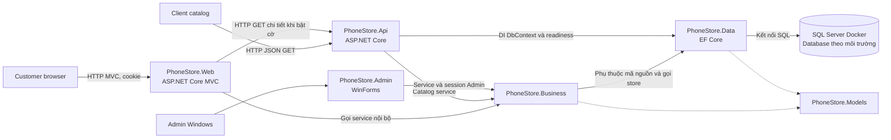

# S34.1 — Kiến trúc backend PhoneStore và lộ trình REST API

Audit ngày 19/11/2026. Endpoint và hành vi trong A–C mô tả source hiện tại hoặc runtime đã kiểm tra. Hợp đồng trong D–I là đề xuất chờ phê duyệt.

## A. Current Backend Architecture

| Project | Trách nhiệm và phụ thuộc |
| --- | --- |
| PhoneStore.Api | ASP.NET Core Controllers, DTO JSON, mapping, vận hành API. Tham chiếu Business, Data, Models. DI hiện đăng ký DbContext, service/store catalog và readiness probe. |
| PhoneStore.Web | MVC/Razor, cookie Customer, session cart, checkout, lịch sử đơn, profile. Tham chiếu Business và Models, dùng Data qua tham chiếu bắc cầu. Typed HTTP client lấy **chi tiết sản phẩm** qua API khi bật feature flag. Catalog listing và các nghiệp vụ Customer còn lại dùng service nội bộ. |
| PhoneStore.Admin | WinForms trên Windows, session Admin trong tiến trình, CRUD, đơn và báo cáo. Qua DI dùng Business/Data và kết nối SQL Server bằng EF Core trực tiếp. |
| PhoneStore.Business | Catalog, auth, profile, order, admin management, reports, kiểm tra nghiệp vụ. Tham chiếu Data và Models. Một số service phụ thuộc store cụ thể, Reporting có interface store. |
| PhoneStore.Data / Models | Data quản lý DbContext, EF mappings, hai migrations, truy vấn và transaction SQL. Models chứa entity và kiểu dữ liệu nghiệp vụ chung. Các DTO API được tách riêng trong Api. |
| Kiểm thử và tooling | Solution có PhoneStore.Tests và AdminBootstrap. SQL integration harness và acceptance tool là project riêng ngoài solution. CI hiện build/test Windows, build Docker image Web/API và kiểm tra Compose trên Ubuntu. |

SDK repo `8.0.427`, host ASP.NET Core/NETCore/WindowsDesktop `8.0.33`. Web/API/Business/Data/Models target `net8.0`, Admin target `net8.0-windows`. Data dùng EF Core SQL Server `8.0.28`. Web tham chiếu EF Design `8.0.11`; cần đồng bộ khi nâng runtime. API dùng Swashbuckle `6.6.2`. .NET 8 đã hết hỗ trợ ngày 10/11/2026. Chuyển sang .NET 10 LTS cần một checkpoint tương thích riêng trước khi mở môi trường production. [Chính sách hỗ trợ .NET](https://dotnet.microsoft.com/en-us/platform/support/policy)

| Component | Current Implementation | Issues | Recommended Improvement | Priority |
| --- | --- | --- | --- | --- |
| Routing / contracts | Controllers, prefix catalog `/api/v1`, DTO camelCase, mapper riêng | Web chỉ tiêu thụ detail qua HTTP. Version nằm trong route. | Giữ nguyên v1 và thêm contract regression cho client hiện có. | P1 |
| DI / Business / Data | Scoped EF DbContext, service/store theo module, SQL Server | Business phụ thuộc Data. Một số service ghi trả lỗi dạng chuỗi; API khó phân biệt xung đột với lỗi hạ tầng. | Mở rộng DI theo nhóm tính năng. Thêm outcome có kiểu cho luồng ghi được chọn, giữ tương thích MVC/WinForms. | P1 |
| Validation | `[ApiController]`, DataAnnotations, `IValidatableObject`, giới hạn query/request-line | Chưa có contract cho body ghi, payload cap theo nghiệp vụ hoặc DTO phân quyền. | Validate DTO theo allowlist rồi xác thực bất biến tại service. | P0 trước API ghi |
| Errors | ProblemDetails, trace ID, handler 500/503, rate 429 và timeout 504 | Lỗi ghi EF cần phân loại theo nguyên nhân. Kestrel có thể từ chối request trước pipeline ứng dụng. | Kiểu lỗi ổn định, validation nhất quán, map conflict nghiệp vụ tại use case. Test response ở cả middleware và host. | P1 |
| Logging | Log method, path, status, thời gian, trace ID. Handler log loại lỗi thay cho thông tin chi tiết. | Chưa có audit hành động admin/API hoặc telemetry tập trung được xác minh. | Log có cấu trúc, mã outcome và audit thao tác đặc quyền. Loại token, body nhạy cảm, địa chỉ và query nhạy cảm. | P1 |
| Auth / CORS | API catalog không có auth middleware, CORS chưa bật. Web dùng cookie/session, Admin dùng session WinForms. | API chưa có policy hoặc kiểm tra ownership. CORS không thay thế auth. | Tách policy bearer cho API. Giữ CORS tắt với tích hợp server-to-server, chỉ cấu hình allowlist nếu có browser client khác origin. | P0 trước route protected |
| Limits / health | Fixed window theo IP, catalog 60/phút, health 120/phút theo mặc định. Timeout 10s/3s. Health kiểm tra kết nối DB. | Chia quota theo IP có thể sai sau proxy. Một probe đang gộp tình trạng process và phụ thuộc SQL. | Trust proxy theo danh sách cấu hình. Bổ sung quota theo actor khi cần. Tách liveness/readiness, giữ endpoint cũ cho Compose. | P1 |
| Swagger / OpenAPI | `v1`, chỉ công bố UI/JSON trong Development | Metadata chưa mô tả đầy đủ lỗi vận hành và hợp đồng route protected chưa có. | Xuất spec có kiểm thử, mô tả auth/status và bảo vệ quyền truy cập tài liệu ở môi trường cần giới hạn. | P1 |
| Tests | ApiFoundationTests, CatalogApiTests, ApiSecurityHardeningTests, typed-client integration, business/SQLite tests. Có SQL harness cách ly. | Chưa có matrix API auth, ownership, write replay và SQL provider parity cho API mới. | HTTP test host, SQL Server disposable, CI contract diff và các ca bảo mật âm. | P0 trước API ghi |

Nguồn repo: [Api Program](../../../src/PhoneStore.Api/Program.cs), [Web Program](../../../src/PhoneStore.Web/Program.cs), [AdminServices](../../../src/PhoneStore.Admin/AdminServices.cs), [catalog resolver](../../../src/PhoneStore.Web/CatalogApi/ProductDetailResolver.cs), [CI](../../../.github/workflows/ci.yml), [S31.3G](../s31-system-analysis/17-REST-API-FINAL-ACCEPTANCE.md).

## B. Existing REST Endpoints

| Method/path | Hợp đồng hiện có | Status chính |
| --- | --- | --- |
| GET `/api/v1/products` | `ProductQueryRequest` → `PagedProductsResponse` và `ProductSummaryResponse`. Search, brandId, categoryId, min/max price, sort, page, pageSize, inStockOnly. Mặc định page 1, size 10, tối đa 50; có tie-break theo ID. | 200, kể cả danh sách rỗng; 400 query sai |
| GET `/api/v1/products/{id}` | `ProductDetailResponse`, thông số, giá, tồn kho và danh sách đường dẫn ảnh | 200; 400 ID sai; 404 thiếu/inactive theo hành vi hiện có |
| GET `/api/v1/brands` | Danh sách active `CatalogOptionResponse` | 200 |
| GET `/api/v1/categories` | Danh sách active `CatalogOptionResponse` | 200 |
| GET `/api/health` | `HealthResponse`, kiểm tra kết nối SQL qua EF | 200; 503 khi SQL unavailable |
| GET `/swagger/v1/swagger.json`, `/swagger` | Spec/UI Development | Có ở Development |

Catalog có thể trả 429, 500, 503 hoặc 504 tùy điều kiện. Health cũng chịu limiter và timeout riêng. `/api/products` không phải route catalog và trả 404. Không có route REST auth, cart, orders, customers, admin management hoặc reports. MVC form, cart JSON và order routes trong Web thuộc host cookie/session riêng. [Controllers](../../../src/PhoneStore.Api/Controllers) · [DTO](../../../src/PhoneStore.Api/Contracts) · [Catalog reader](../../../src/PhoneStore.Data/Catalog/ProductCatalogReader.cs)

## C. Kiến trúc hiện tại

Các host tạo DI scope và kết nối SQL riêng. Business và acceptance dùng chung SQL instance trong môi trường hiện tại, khác database, login acceptance và Web/API containers. Admin có thể dùng SQL Windows hoặc SQL Docker theo cấu hình launcher.

## D. REST API Gap Analysis

| Nhóm / hiện trạng | Endpoint đề xuất và ưu tiên | Service / DTO / validation | Quyền, status và kiểm thử |
| --- | --- | --- | --- |
| Auth — chỉ MVC/WinForms | P0 cho API protected. API xác thực token từ issuer OIDC. `GET /api/v1/me` tùy nhu cầu kiểm chứng. Route token/refresh thuộc issuer. | Dùng policy và tra trạng thái hiện tại từ AuthUserStore/identity mapping. DTO `CurrentUserResponse` tối thiểu. Validate issuer, audience, chữ ký, expiry, subject mapping. | Self. 200/401/403. Test token hết hạn, sai issuer/audience, account disabled, role thay đổi và rotation theo cơ chế issuer. |
| Products — list/detail đã có | P1 giữ hai GET. Mở rộng filter chỉ nếu có client cần parity. CRUD thuộc admin. | IProductService, DTO hiện có. Giới hạn page size, range và sort. | Catalog đọc. 200/400/404/429 và lỗi vận hành. Test shape, sort/paging, inactive, ảnh và API-to-Web detail compatibility. |
| Brands — GET đã có | P2 giữ GET. Admin mutation tùy nhu cầu. | IProductService và ILookupManagementService khi được chọn. `CatalogOptionResponse`, DTO ghi tên/mô tả riêng. | Đọc catalog, ghi Admin. 200/400/409 khi trùng. Test active, trim, uniqueness và phân quyền. |
| Categories — GET đã có | P2 giữ GET. Admin mutation tùy nhu cầu. | Cùng store pattern với Brand. DTO riêng khi khác validation. | Đọc catalog, ghi Admin. 200/400/409. Test active, trùng và kiểm thử không cascade ngoài quy tắc. |
| Cart — Web session/cart count | P3 giữ cart trong Web. Nếu có mobile, thiết kế cart riêng hoặc gửi line items khi tạo order. | SessionCart và CartPresenter giữ phía Web. Nếu cần contract mới, `CartLineRequest` gồm product ID/quantity, kiểm tra giới hạn số dòng và tồn. | Web cookie/session hiện có. Future API scoped cho owner, 200/400/409. Test đổi account, isolation, kết quả khi tồn thay đổi. |
| Orders — chỉ MVC/WinForms | P1 `GET /api/v1/orders`, `GET /api/v1/orders/{id}` trước. `POST /api/v1/orders` và `POST .../{id}/cancel` sau. | IOrderService, IOrderManagementService. `OrderQueryRequest`, `OrderSummaryResponse`, `OrderDetailResponse`, `CreateOrderRequest`. Lấy user từ danh tính đã xác thực. Kiểm tra paging, ngày, lượng hàng, giao hàng và idempotency key. | Customer owner. 200, 201 + Location khi tạo mới, 200 replay cùng payload, 400/401/403/404/409. Test sở hữu, giá server, rollback, oversell, cancel/replay SQL cách ly. |
| Customers — Profile MVC và WinForms | P2 `GET/PATCH /api/v1/me/profile` nếu có client cần. Danh sách khách chỉ dành cho Admin. | ICustomerProfileService / ICustomerManagementService. `ProfileResponse`, `UpdateProfileRequest` chỉ họ tên/điện thoại/địa chỉ. Giữ email chỉ đọc. | Self hoặc Admin scope riêng. 200/400/401/403/404 theo route. Test overposting, RBAC và không lộ PII ngoài scope. |
| Admin — WinForms trực tiếp SQL | P1 nội bộ. Chọn một lát cắt trước, ưu tiên đọc orders rồi transition theo nhu cầu. Product/lookup/customer writes và ảnh là mở rộng riêng. | Management services hiện có, DTO tách đọc/ghi, expected status/version cho update. Thiết kế upload stream/size riêng nếu cần. | Admin policy theo hành động và fresh auth cho ghi. 200/201/204, 400/401/403/404/409. Test stale state, single-admin, quyền đã bị thu hồi và không DML khi từ chối. |
| Reporting — WinForms | P2 nội bộ. `GET /api/v1/admin/reports/sales` và `.../revenue-series` nếu cần dashboard/API consumer. | IReportingService. `ReportQueryRequest`, `SalesReportResponse`, `RevenueSeriesResponse`. Kiểm tra ngày địa phương, kỳ và trần khoảng. | Admin read policy. 200/400/401/403/503. Test Completed-only, SQL grouping, 00:00 UTC+7, empty range và giới hạn tải. |

Đối với tạo đơn, hủy đơn và hoàn tồn, giữ transaction và bất biến trong Business/Data. Idempotency hiện tại dùng mã đơn suy ra từ user và token, khóa checkout và unique order code. **Cần định nghĩa fingerprint payload cho hợp đồng mới** vì cùng key với payload khác hiện có thể trả lại order cũ. Dùng outcome có kiểu để ánh xạ HTTP status. Khi không chắc commit đã thành công, chỉ retry với cùng key và tra trạng thái theo owner. [OrderService](../../../src/PhoneStore.Business/Purchasing/OrderService.cs) · [PurchaseStore](../../../src/PhoneStore.Data/Purchasing/PurchaseStore.cs)

## E. Security Assessment

- **Bearer và refresh.** Ưu tiên issuer OIDC có sẵn và JWT access token ngắn hạn. API xác minh issuer/audience/chữ ký/expiry qua metadata và khóa tin cậy. Browser/native chọn Authorization Code + PKCE khi cần OAuth client. Với public client, dùng refresh rotation và phát hiện reuse hoặc sender-constrained token do issuer hỗ trợ. Token đã ký có thể còn hiệu lực đến expiry. Ghi nhạy cảm cần kiểm tra trạng thái/role hiện tại và xác định SLA thu hồi. Nếu issuer cần lưu refresh state, storage/migration là quyết định riêng. [JWT bearer validation](https://learn.microsoft.com/en-us/aspnet/core/security/authentication/configure-jwt-bearer-authentication?view=aspnetcore-8.0) · [RFC 9700](https://www.rfc-editor.org/rfc/rfc9700.html)
- **Quyền truy cập.** API mới yêu cầu authenticated theo mặc định cho nhóm protected, quyền theo policy và ownership theo user nội bộ ánh xạ từ subject tin cậy. Dùng 401 cho thiếu/token không hợp lệ, 403 cho thiếu quyền, 404 cho order thiếu hoặc thuộc Customer khác. Admin writes cần phân tích ranh giới fresh-check và commit nếu yêu cầu thu hồi tức thời.
- **Cookie và Admin.** Duy trì ASP.NET Core cookie/session/CSRF ở Web và session WinForms hiện tại. Cookie Customer không được chấp nhận làm bearer cho API. `PasswordHasher<User>` có sẵn và có thể rehash khi đăng nhập. Giữ hash ngoài DTO và logs. Tích hợp Admin qua API về sau cần PKCE với browser hệ thống và đánh giá quyền SQL trực tiếp riêng.
- **Runtime và secrets.** Business API Docker đang chạy Development, dùng `sa`, TLS có encryption nhưng trust server certificate. Acceptance dùng login giới hạn theo DB. Trước production, giới hạn quyền SQL theo từng host, inject secret từ store vận hành, bật TLS kiểm chứng certificate và đặt môi trường Production. Nếu có proxy, cấu hình proxy tin cậy trước khi dùng forwarded IP; quota auth/write theo IP và user khi phù hợp. Chỉ bật CORS cho origin/method/header đã duyệt. Redact PII, cookies, bearer, token refresh và connection strings.

## F. Recommended Architecture

| Phương án | Độ phức tạp / chi phí chuyển | Reuse, testability, maintainability | Phù hợp |
| --- | --- | --- | --- |
| A. Mở rộng kiến trúc hiện tại | Thấp | Tận dụng service/store hiện có. Tăng test HTTP nhanh. Cần quy ước module để tránh Program/Controllers phình to. | Tốt nhất cho S34.2–S34.5 |
| B. Modular monolith | Vừa nếu chỉ nhóm code theo feature, cao nếu tách schema và DI đồng thời | Hợp đồng module rõ hơn, test theo use case và review dễ hơn. | Áp dụng ranh giới module dần trong các project hiện có |
| C. Clean Architecture | Vừa–cao do Business đang tham chiếu Data và nhiều store cụ thể | Đảo chiều dependency giúp test use case nhưng tăng số interface và chi phí chuyển MVC/WinForms. | Chỉ tách port khi có nhu cầu thực tế ở order/auth/report |

**Chọn A với tổ chức theo nhóm nghiệp vụ của B.** Controller mỏng, DTO API riêng, dùng chung use case và một SQL Server theo môi trường. Chuyển từng luồng, giữ API catalog v1 tương thích. Các host hiện có phục vụ đủ phạm vi đồ án.

## G. Detailed S34 Roadmap

Tên file dưới đây là vị trí dự kiến, tùy kết quả triển khai. Mỗi giai đoạn cần checkpoint riêng và nghiệm thu trên môi trường cách ly trước khi đề xuất deploy.

| Giai đoạn | Scope, file và contract dự kiến | Rủi ro và test/acceptance | Rollback |
| --- | --- | --- | --- |
| **S34.2 Foundation** | Api Program/Infrastructure/Health, ApiFoundationTests và CatalogApiTests. Cố định schema JSON và lỗi v1, thêm `GET /health/live`, `GET /health/ready`, giữ `GET /api/health`. Tách spike .NET 10 cho global.json, csproj, Dockerfile và CI ở checkpoint riêng. | Startup/Compose health và Web detail dễ regression. Test route/status/JSON tương thích, live không phụ thuộc SQL, ready 503 khi DB unavailable qua test double, log redaction. Target runtime được hỗ trợ trước go-live. | Revert checkpoint foundation hoặc runtime riêng, redeploy image trước khi đã được phê duyệt. Không DDL ở foundation. |
| **S34.3 Auth & Authorization** | Api Program, Authentication/Authorization, `MeController` nếu cần, integration tests. Bearer OIDC và policy Customer/Admin; issuer quản lý token/refresh. | Subject mapping, credential leak, role cũ. Test 401/403, issuer/audience/expiry, role/disable, ownership policy, rotation/reuse của issuer. Web cookie/WinForms giữ nguyên. | Tắt route protected theo cấu hình, giữ catalog. Quản lý khóa/token qua issuer với rollback được duyệt. |
| **S34.4 Catalog** | Api Controllers/Contracts, CatalogContractMapper, ProductCatalogReader nếu có bằng chứng. Duy trì bốn GET v1, nâng contract tests và parity theo nhu cầu. | Lệch filter, trang, inactive hoặc relative image. Test SQL projection/order và Web client ON/OFF. Chấp nhận khi không có contract regression. | Revert phần bổ sung hoặc disable feature ở consumer bằng quyền triển khai riêng; giữ v1. |
| **S34.5 Orders** | OrdersController, Orders DTO, IOrderService/OrderService/PurchaseStore, SQL integration. GET list/detail trước, POST create/cancel sau. | Ownership, oversell, retry, commit mơ hồ và hủy lặp. Yêu cầu 404 khác chủ, giá server, rollback, stock không âm, replay không trừ tồn thêm và 409 khi key khác payload. Data change nếu cần cơ chế fingerprint được phê duyệt riêng. | Tắt route ghi trước, giữ đơn đã commit và tra theo key để đối soát; rollback image nếu schema tương thích. |
| **S34.6 Admin management** | Admin controllers/DTO và policy, Management services. Pilot GET orders và POST status transition. Sản phẩm/lookup/customer thêm theo client. | Stale state, race revoke, lộ PII, upload file. Test Admin-only, transition 409, revoke trước thao tác, audit và deny không ghi. Chốt tiêu chí atomic authorization trước mở write. | Tắt routes Admin, tiếp tục WinForms hiện có. Giữ lịch sử thay đổi và đối soát nghiệp vụ. |
| **S34.7 Reporting** | ReportsController, DTO, ReportingService/Store/Calendar nếu cần. GET sales/series nội bộ. | UTC+7, query nặng và lộ thông tin vận hành. Test Completed-only, biên nửa mở, bucket thiếu dữ liệu, 366 ngày cho series tùy chỉnh, SQL provider. | Tắt reports API, WinForms tiếp tục truy vấn hiện có. |
| **S34.8 Security & Performance** | Api infrastructure, hosting/deployment riêng khi duyệt, query profiling. Rate limit, trusted proxy, least privilege, cache GET catalog nếu cần, trace và metrics. | Ước lượng tải sai, cache dữ liệu cũ, lock/contention. Test 429/Retry-After, timeout, quota auth, query plan, tài nguyên và secret scan trên môi trường cách ly. | Quay cấu hình đã xác minh hoặc tắt cache. Duy trì các guard bảo mật bắt buộc khi rollback. |
| **S34.9 OpenAPI, Tests & Docs** | Swagger/OpenAPI metadata, tests/CI và docs. Spec versioned, mẫu request/response và runbook. | Drift giữa spec, source và runtime. Test contract diff, SQL integration cách ly, health/Swagger theo môi trường. Chấp nhận khi pipeline cấp bằng chứng reproducible. | Revert thay đổi doc/pipeline hoặc phục hồi spec đã công bố, giữ API v1 tương thích. |

## H. Risks & Dependencies

- Hết hỗ trợ .NET 8, Development runtime, `sa` và TLS trust override là điều kiện cần xử lý trước môi trường production.
- API và Web cùng đọc SQL; checkout, order status và idempotency phải giữ bất biến cùng các client hiện có. Thêm paged admin read nếu pilot cần, vì các interface list Admin hiện trả collection.
- Chốt issuer/subject mapping, bên sở hữu refresh state, quyền DB theo host và chính sách PII trước route protected. Không dựng shared SQL instance business làm môi trường ghi hoặc stress.
- SE01 runtime vẫn BLOCKED và RP01 còn thiếu fixture biên giờ. Chúng cung cấp ca test cho S34.6/S34.7, giữ nguyên trạng thái từ S32. [S32 handoff](../s32/S32_3B_FINAL_HANDOFF.md)

## I. Recommended First Implementation

Sau phê duyệt, bắt đầu S34.2 với contract guard cho API v1, health split tương thích và baseline lỗi/trace. Ưu tiên 4 GET catalog, endpoint health hiện có và HTTP client Web Detail. Chạy song song về mặt kế hoạch một spike .NET 10 trên môi trường cách ly, checkpoint độc lập trước thay đổi xác thực. Chưa cần auth server tự viết, API ghi, thay đổi Windows Admin hoặc migration.

## J. Git / Runtime Safety Status

- `main` ban đầu sạch ở `b0d07a73119cba4e09367e3f17bcee1ae4df0594`. `git ls-remote --exit-code origin refs/heads/main` xác nhận chính GitHub main trỏ cùng hash. Commit chứa CT02, acceptance scripts/tool và S32 handoff. Chỉ hai tài liệu audit/progress phát sinh sau đó.
- Docker Engine `29.9.2`, Compose `v5.6.1`. Business SQL/Web/API và acceptance Web/API **5/5 healthy**. API hai môi trường dùng cùng image `sha256:9b20d979aa6a…`, database thực tế theo cấu hình lần lượt `PhoneStoreDB` và `PhoneStoreDB_AcceptanceTest`. Business API SQL dùng `db,1433`, acceptance dùng `host.docker.internal,14334`.
- HTTP GET trên 5025 và 5286 xác nhận health, list, brands, categories và Swagger JSON đều 200. ID 0 trả 400 trên cả hai. Business ID không tồn tại và route bỏ version trả 404. Kiểm tra này xác nhận HTTP và readiness. Không chạy lại SQL snapshot hoặc 249 test từ S32.
- Chỉ kiểm tra source/Git/Docker/GET và cập nhật tài liệu. Không thay source, DB, runtime, stage, commit hoặc push.
